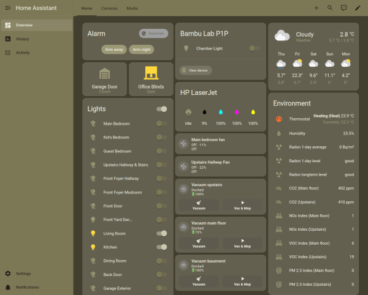
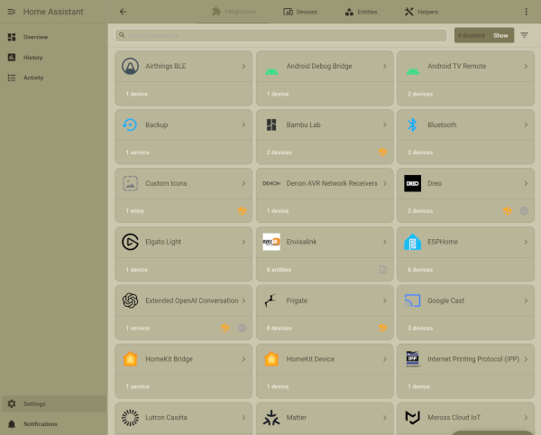

# Home Assistant IBM1970 Theme

[](https://github.com/andornaut/homeassistant-ibm1970-theme/actions/workflows/test.yml)
[](https://opensource.org/license/MIT)

An IBM and 1970s inspired dark and light color theme for
[Home Assistant](https://www.home-assistant.io/).

[](./screenshots/dark-colors.png)
[](./screenshots/light-colors.png)

This color theme is part of the
[IBM1970 desktop theme](https://github.com/andornaut/ibm1970-desktop-theme).

## Installation

Copy [`./themes/ibm1970.yaml`](./themes/ibm1970.yaml) to `${HomeAssistant}/config/themes/`.

See
[ansible-ctrl homeautomation role](https://github.com/andornaut/ansible-ctrl/tree/main/roles/homeautomation)
for an example of the installation procedure.

## Development

Checks require Make and Docker 29.9.3, matching CI. The project-owned containers
live in `tests/container/`. Verification mounts only a read-only source snapshot
and scratch storage.

```bash
make check
make check-info
```

The full gate runs the declared lint checks. No test suite or build is declared.
